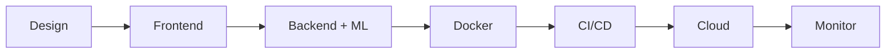

 

 &nbsp;&nbsp;  &nbsp;&nbsp;  &nbsp;&nbsp; 

 

---

<h2> &nbsp;About Me</h2>

| | |
|:--|:--|
|  | **Full Stack Developer** turning into an **AI & Data Science** engineer |
|  | **M.Sc. Artificial Intelligence & Data Science** *(Pursuing)* |
|  | Founder, **[Adithyaprabu Digital Studio](https://adithyaprabudigitalstudio.vercel.app)** |
|  | Tamil Nadu, India · [Portfolio](https://aadhi9345.github.io/adithyaprabu.github.io/) |

---

<h2> &nbsp;What I Do</h2>

<table>
<tr>
<td align="center" width="25%"> <b>Full Stack</b> React · Next.js · PHP · MySQL</td>
<td align="center" width="25%"> <b>AI & Data Science</b> ML · DL · Data Analysis · LLM & RAG</td>
<td align="center" width="25%"> <b>MLOps</b> Docker · CI/CD · Model Serving</td>
<td align="center" width="25%"> <b>Cloud</b> AWS · Azure · GCP · Vercel</td>
</tr>
</table>

---

<h2> &nbsp;How I Ship: Idea to Production</h2>

---

<h2> &nbsp;Tech Arsenal</h2>

**Languages**

**Full Stack**

**AI / Data Science**

**MLOps & DevOps**

**Cloud**

**Databases & Design**

---

<h2> &nbsp;Skill Roadmap</h2>

| Domain | Level | Progress |
|:--|:--:|:--|
| Full Stack Development | Advanced-Intermediate |  |
| UI / UX Design | Intermediate |  |
| AI & Data Science | Growing (M.Sc. in progress) |  |
| MLOps | Learning |  |
| Cloud Computing | Learning |  |

---

<h2> &nbsp;Currently Working On</h2>

| Track | Focus |
|:--|:--|
| **AI & Data Science** | M.Sc. coursework · Machine Learning · Deep Learning (PyTorch) · Pandas/NumPy · LLM APIs & RAG |
| **MLOps** | Docker · GitHub Actions CI/CD · Model serving with FastAPI · MLflow |
| **Cloud** | AWS (EC2, S3, Lambda) · Azure fundamentals · Vercel Edge · Infrastructure as Code |
| **Full Stack** | Next.js App Router · Server Components · SSR & ISR · Design systems |

---

<h2> &nbsp;Experience</h2>

<b>Adithyaprabu Digital Studio — Founder & Full Stack Developer · 2026 – Present</b>

 

> `Next.js` `React` `Tailwind CSS` `PHP` `JavaScript` `Figma` `Vercel`

- Founded a freelance digital studio delivering **custom websites, design portfolios and creative video editing** for businesses across India.
- End-to-end delivery, from **Figma wireframe to Vercel production**, with a modern UI/UX focus.
- Expanding services toward **AI-powered features and cloud-based deployments**.
- Live: [adithyaprabudigitalstudio.vercel.app](https://adithyaprabudigitalstudio.vercel.app)

<b>Hapitrend Media — Web Development Intern · May 2025</b>

 

> `HTML5` `CSS3` `Bootstrap 5` `JavaScript` `PHP` `MySQL`

- Built **Gameszone**, a full stack eCommerce app with real-time cart, session login and full admin CRUD.
- MySQL schema handling **500+ product entries**; admin panel cut manual work by **40%**.
- **100% responsive** gaming UI with custom CSS3 animations.

<b>NoviTech R&D Pvt. Ltd. — Full Stack MasterClass · Mar – Apr 2024</b>

 

> `HTML5` `CSS3` `JavaScript` `Bootstrap` `PHP` `MySQL`

- Intensive **30-day program**: built **5+ full stack projects** end-to-end.
- Earned an industry-recognised full stack development certificate.

---

<h2> &nbsp;Featured Projects</h2>

| Project | Stack | Status |
|:--|:--|:--:|
| **[Adithyaprabu Digital Studio](https://adithyaprabudigitalstudio.vercel.app)** Premium freelance studio · SEO-optimised · High-converting layout | `Next.js` `React` `Tailwind` `Vercel` | Live |
| **[Gameszone eCommerce](https://games---zone.my-style.in)** 50+ listings · 500+ DB records · Real-time cart · Admin panel | `PHP` `JS` `MySQL` `Bootstrap 5` | Live |
| **[SriMusic Streaming](https://sri-music.is-great.net)** 100+ Tamil songs · Custom audio player · Live search · Play-count | `PHP` `JS` `MySQL` `HTML5/CSS3` | Live |
| **AI-Powered Web App** *(in progress)* LLM / RAG feature integrated into a deployed web product | `Python` `FastAPI` `Docker` `Cloud` | Building |

---

<h2> &nbsp;3D Contribution City</h2>

 

 

---

<h2> &nbsp;Certifications & Education</h2>

| Achievement | Issued By | Year |
|:--|:--|:--:|
| Web Development Internship | Hapitrend Media | 2025 |
| Full Stack Development MasterClass | NoviTech R&D Pvt. Ltd. | 2024 |
| National Conference Certificate | Bharathidasan University | 2025 |
| JavaScript Programming — Value Added | J.J. College of Arts & Science | 2024–25 |
| Python Libraries — Value Added | J.J. College of Arts & Science | 2024–25 |
| Power Query in 40 Minutes | Online Certification | 2024–25 |

**M.Sc. Artificial Intelligence & Data Science** — *Pursuing*
 **B.Sc. Computer Science** — J.J. College of Arts & Science · Bharathidasan University · *2023 – 2026*
 *Core: OS · RDBMS · Software Engineering · Computer Networks · IoT · Microprocessor*

---

<h2> &nbsp;2026–27 Goals</h2>

- [x] Launch Adithyaprabu Digital Studio
- [x] Complete B.Sc. Computer Science
- [ ] Excel in M.Sc. AI & Data Science and build ML projects alongside coursework
- [ ] Ship an AI-powered web product (LLM + RAG)
- [ ] Containerise projects with Docker & automate with GitHub Actions
- [ ] Earn a cloud certification (AWS Cloud Practitioner / Azure AZ-900)
- [ ] Deploy an ML model end-to-end with an MLOps pipeline

---

<h2> &nbsp;Let's Connect</h2>

 

*"Build clean. Ship fast. Deploy smart."*

